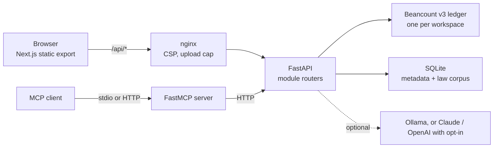

# Aurum

A self-hosted, bilingual (Spanish/English) personal finance and tax assistant for Mexico and the United States, where every figure is computed by tested code and explained with its citation.

Aurum is first an everyday money app: accounts and what you owe, income and pay days, fixed payments, every expense logged by hand from one **+ Agregar** dialog, one honest "available until <date>" figure, budgets per category and goals tied to real accounts. All of it sits on a double-entry [Beancount](https://github.com/beancount/beancount) ledger. Behind an **Avanzado** menu, the same ledger feeds the tax side: a cited rule registry for Mexico (RESICO persona física, IVA, the general regime, Nuevo León payroll tax) and the US (federal and Texas), an audit of the declaration SAT prefills from CFDI invoices, a research console over tax law that cites or abstains, a law-change tracker, and a local MCP server so your own AI tools can use it. It is for people in Mexico or between Mexico and the US who want their financial data to stay on their own machine, and it is built as decision support: it drafts and explains, and a person reviews and files.


**No hosted demo.** The stack runs locally with Docker and seeds synthetic demo workspaces on first boot; all screenshots show that demo data.

## Contents

- [Features](#features)
- [Engineering highlights](#engineering-highlights)
- [Tech stack and design decisions](#tech-stack-and-design-decisions)
- [Getting started](#getting-started)
- [Configuration](#configuration)
- [Tests, lint and CI](#tests-lint-and-ci)
- [Security and limitations](#security-and-limitations)
- [Documentation](#documentation)
- [License](#license)
- [Author](#author)

## Features

**Everyday money (the default, "simple" mode)**

- **Accounts and net worth.** Bank, cash, credit cards, loans and investment accounts. For a card or a loan you type what you owe as a positive number; the server stores it signed, so net worth is always the signed sum. Cards carry cut day, due day, limit and APR with a usage bar.
- **Movements.** One **+ Agregar** dialog for expenses, income and transfers, with categories, tags, payee and split transactions. Editing or deleting never rewrites history: a reversing transaction is appended and every report reads through one filter that skips voided entries.
- **Fixed payments and income.** Typed by hand, shown on a Monday-first calendar; "Pagado" turns an occurrence into a real, undoable movement. Detecting them from bank lines is an optional shortcut.
- **One "Disponible hasta el <fecha>".** Balance minus pending fixed payments, minus what is left in budgets, minus a buffer, with the calculation one click away. It is the only safe-to-spend number in the app.
- **Budgets and goals.** Monthly budgets per category with rollover, 80% and 100% alerts and copy-forward. Savings goals with a target date, the required monthly amount and a linked account; debt goals with a what-if for extra payments.
- **Shortcuts that stay editable.** One-line quick add (`250 tacos comida`), CSV statement import onto a chosen account with de-duplication, and receipt photos read by Tesseract OCR (EXIF stripped, only empty fields are filled, nothing is saved until you press Guardar).
- **Backups.** Per-workspace backup zip and movements CSV from Ajustes; a full data backup with a sha256 manifest; restore only into a new directory.


**Tax, research and the rest (Avanzado)**

- **RESICO month close and prefill audit.** CFDI 4.0 XML in, cash-basis income out (PUE in the issue month, payment complements by `FechaPago`, PPD without a complement not counted), ISR under LISR art. 113-E and IVA under LIVA art. 5, then a line-by-line explanation of where SAT's prefilled declaration will differ from reality. Output is a bilingual PDF watermarked DRAFT.
- **18 cited tax rules.** RESICO, IVA, the general regime's provisional payments, IMSS and INFONAVIT employer quotas, Nuevo León payroll tax, US Schedule C, self-employment tax, income tax and quarterly estimates, Texas franchise and sales tax, and a US/MX cross-border profile (residency, treaty tie-breaker, FBAR, FEIE vs FTC).
- **Research console.** Questions in Spanish or English over an ingested law corpus; answers cite law, article, effective date and trust tier, or abstain.
- **Law tracker.** Monitored sources, change detection, versioned re-indexing and impact triage; a change that touches a rate files a proposed rule update for a person to approve.
- **Business workspaces.** Charts of accounts for a Mexican persona moral and a US LLC, payroll runs (idempotent per period), an invoice register and KPIs.
- **Also:** investment holdings with lots and contribution limits, a credit-report import, scenario planning (debt payoff, buy vs rent, retirement Monte Carlo, RESICO vs general regime), report packs, YAML workflows, deterministic insights with an optional Telegram digest.
- **Local MCP server.** Ten tools (`search_law`, `calc_tax`, `prefill_diff`, `quick_add`, `post_entry`, `balances`, `financial_statement`, `goal_status`, `budget_status`, `get_law_changes`) over stdio or HTTP.


## Engineering highlights

1. **Numbers come from a cited, versioned rule registry, never from a model.** A rule is `id · version · citation · effective range · compute()`, and its result carries an `Explain`: a one-line summary, the worked steps, the citations and the rule versions used. Every rule ships YAML test vectors, and a test fails if a registered rule has none. Constants that were not confirmed in a primary source are flagged `verified=False`, render `(verify)` and lower the result's confidence; the ones that were confirmed record the source and the date it was read (for example the 2026 monthly ISR tariff against Anexo 8 of the RMF). See [`aurum/rules/`](aurum/rules/), [`aurum/core/explain.py`](aurum/core/explain.py) and [`docs/modules/rules.md`](docs/modules/rules.md).
2. **The ledger is the truth, and nothing is rewritten.** Every financial fact is a Beancount transaction appended under a per-workspace lock; SQLite only holds metadata. Edits and deletes append reversing entries, and every read that matters goes through one `live_txns` filter. Each write is validated and the rendered directive is parsed back before it touches the file, which blocks directive injection. Schema migrations are versioned per module, never delete data, refuse to run a data migration on a protected workspace, and refuse to start against a database written by a newer version. See [`aurum/pf/ledger_view.py`](aurum/pf/ledger_view.py), [`aurum/ledger/beancount_store.py`](aurum/ledger/beancount_store.py) and [`aurum/core/db.py`](aurum/core/db.py).
3. **Cash basis the way SAT counts it, audited against the prefill.** The prefill audit classifies issued and received CFDIs with SAT's own prefill rules, reconciles them against bank lines, and turns every gap (a PUE invoice never collected, a PPD with no payment complement, a cash-paid expense, a deposit with no invoice) into a cited difference instead of a silent number. See [`aurum/tax/`](aurum/tax/) and [`docs/modules/tax.md`](docs/modules/tax.md).
4. **Grounded or silent research.** Retrieval is SQLite FTS5 plus embeddings fused with reciprocal rank; an answer must clear a support threshold on a trusted source or it abstains, and corpus text is treated as data, never as instructions. A 15-question eval set measures precision@1 on cited articles. When the model call fails, or Claude stops with a refusal, the endpoint still answers with the cited excerpts. See [`aurum/corpus/`](aurum/corpus/), [`aurum/research/`](aurum/research/) and [`docs/research-eval.md`](docs/research-eval.md).
5. **Safe as shipped, stricter when exposed.** Ports bind to `127.0.0.1` by default. Host, Origin and path guards run on every request; binding to the LAN makes the API generate and require a bearer token; there is no CORS unless you list an origin; uploads, zip members and fetches are capped; research URL ingest has an SSRF guard; PII is masked in every log record; cloud LLM calls are refused unless you opt in. The API container starts as root only to fix volume ownership, then drops to an unprivileged user with every capability cleared. See [`docs/SECURITY.md`](docs/SECURITY.md).
6. **A bilingual UI with its own lint rules.** The Next.js app is a static export behind nginx. Besides ESLint, `npm run lint` fails on untranslated or duplicated i18n keys, on banned vocabulary in user-facing copy, and on colour pairs below the contrast threshold. A fake in-browser API (`npm run dev:mock`) mirrors real response samples so the UI can be developed without the backend.

## Tech stack and design decisions



- **Beancount v3 as an unmodified engine.** Plain-text double-entry books are auditable and diffable, and Beancount's commodities and lots give investment tracking for free. Aurum talks to it through its library API and never forks it.
- **FastAPI with routers by convention.** Each module exposes a router and an optional `schema.sql`; the app mounts what exists. Pydantic v2 models define every request and response; money is `Decimal` on the server and a string on the wire.
- **SQLite for metadata and the law corpus.** One file for labels, budgets, goals, inbox, audit and rule versions; another for the corpus with an FTS5 index and embeddings. A single-user, self-hosted app does not need a database server.
- **Local models first.** Ollama is the default provider (`llama3.1:8b` for prose, `nomic-embed-text` for embeddings); Claude (`claude-opus-5-5` by default), OpenAI and LM Studio sit behind the same interface. Models only classify, summarise and draft; they never produce a figure.
- **Next.js 15 static export behind nginx.** Every page is client-rendered, so the build is plain files; nginx serves them, sets the security headers and proxies `/api`. The UI is Spanish-first with English as a full second language.
- **FastMCP** exposes the API as MCP tools. Each tool is a plain HTTP call to the API, so the MCP server goes through the same auth and validation as the UI instead of reaching into the modules directly.

```text
aurum/                Python package: api, core, ledger, rules, tax, pf, organizer, ingest, satsync,
                      corpus, llm, research, updater, insights, business, plan, ... (one folder per module)
web-ui/               Next.js app, nginx image, UI lint scripts and Vitest tests
tests/                pytest suite, one folder per module; synthetic law excerpts in tests/fixtures/law
scripts/              law ingest, license audit, restore, Telegram digest, end-to-end verification
docker/               API entrypoint and privilege-drop scripts
docs/                 architecture, spec, security, operations, module references, tutorials
docker-compose.yml    api + web-ui
Dockerfile.api        API image (Python 3.11, uv, Tesseract)
```

[`docs/ARCHITECTURE.md`](docs/ARCHITECTURE.md) has the principles, the module conventions, the core types and the on-disk layout.

## Getting started

### Docker (recommended)

Requires Docker with Compose v2.

```bash
git clone https://github.com/jadrianlg16/aurum.git
cd aurum
docker compose up --build
```

Open <http://localhost:5024>. On first boot the API seeds four synthetic workspaces: `demo-personal` for the everyday screens, `demo-mx` for RESICO, `demo-biz` for a business and `demo-us` for Texas. The first visit shows a welcome screen that either creates your own workspace (`personal`, protected by default) or opens the demo; the selector at the top switches between workspaces. Everything is stored under `./data` on the host. Ports are published on `127.0.0.1` only; read [Security](#security-and-limitations) before changing `AURUM_BIND`.

Research answers and AI summaries use [Ollama](https://ollama.com) on the host if it is running (`ollama pull llama3.1:8b` and `ollama pull nomic-embed-text`). Everything else works without it.

### Local development

Requires Python 3.11 with [uv](https://docs.astral.sh/uv/), and Node 20.

```bash
uv sync --all-extras
export AURUM_DATA_DIR=/tmp/aurum-dev            # never point a dev run at your real data
uv run python -m aurum.demo                      # seed demo-mx (plus the business and US demos)
uv run python -m aurum.demo --refresh            # add demo-personal; both are idempotent
AURUM_ALLOWED_ORIGINS=http://localhost:3000 uv run aurum-api     # API on :5041

cd web-ui
npm ci
NEXT_PUBLIC_API_URL=http://localhost:5041/api npm run dev        # UI on :3000
```

`npm run dev:mock` runs the UI against an in-browser fake API instead, with no backend at all. The MCP server runs with `uv run aurum-mcp` (stdio) or `uv run aurum-mcp --http` (port 5042). [`docs/OPERATIONS.md`](docs/OPERATIONS.md) covers migrations, backups, restore and the end-to-end check.

## Configuration

Everything has a default; copy [`.env.example`](.env.example) to `.env` to change it. The main variables:

| Variable | Default | Purpose |
|---|---|---|
| `AURUM_PORT` | `5024` | Host port for the web UI. |
| `AURUM_MCP_HOST_PORT` | `5042` | Host port for the MCP server over HTTP. |
| `AURUM_DATA_DIR_HOST` | `./data` | Host folder for ledgers, SQLite, the vault and backups. |
| `AURUM_BIND` | `127.0.0.1` | Interface Compose publishes on. `0.0.0.0` exposes the stack and makes the API require a token. |
| `AURUM_API_TOKEN`, `AURUM_REQUIRE_TOKEN` | empty, `0` | Explicit bearer token; require one even on loopback. |
| `AURUM_ALLOWED_ORIGINS`, `AURUM_ALLOWED_HOSTS` | empty | Extra browser origins (CORS) and Host header values. |
| `AURUM_LLM_PROVIDER`, `AURUM_LLM_MODEL` | `ollama`, `llama3.1:8b` | `ollama`, `lm_studio`, `claude` or `openai`. With `claude`, the model defaults to `claude-opus-5-5`. |
| `AURUM_EMBED_MODEL` | `nomic-embed-text` | Embedding model for the law corpus (`hash` for an offline backend). |
| `OLLAMA_URL` | `http://host.docker.internal:11434` | Ollama endpoint as seen from the container. |
| `AURUM_CLOUD_OPT_IN`, `ANTHROPIC_API_KEY`, `OPENAI_API_KEY` | `0`, empty | Cloud providers are refused unless opt-in is `1`. |
| `AURUM_OCR_BACKEND`, `AURUM_OCR_URL` | `auto`, empty | Receipt OCR: Tesseract (in the image), an external OCR service, or off. |
| `AURUM_SEED_DEMO` | `1` | Seed the synthetic demo workspaces on boot. |
| `AURUM_DEMO_MODE` | `0` | `1` makes the API read-only apart from a small allow-list. |
| `AURUM_MAX_UPLOAD_MB`, `AURUM_RATE_LIMIT_PER_MIN` | `25`, `600` | Body cap (nginx and API) and per-IP rate limit. |
| `TELEGRAM_BOT_TOKEN`, `AURUM_TELEGRAM_WS_MAP`, `AURUM_TELEGRAM_SECRET` | empty | Optional Telegram digest and quick-add webhook. |

The full list, with the zip, fetch and migration settings, is in `.env.example` and [`docs/SECURITY.md`](docs/SECURITY.md).

## Tests, lint and CI

```bash
uv run ruff check aurum tests scripts
uv run pytest

cd web-ui
npm run typecheck && npm run lint && npm test && npm run build
```

On 2026-10-02 the backend suite ran 1,428 tests, all passing, on Python 3.11 with no model and no network access, and the web UI ran 144 Vitest tests (one skipped) plus its lint checks and a clean static build. The backend tests cover every tax rule through its YAML vectors, the ledger store and its migrations, the personal-finance and organizer APIs (void semantics, liabilities, budgets, goals, safe to spend), CFDI and CSV ingest, the security guards, the research corpus with an offline embedding backend, the MCP tools through an in-process transport, and the scripts. Every test runs against a temporary data directory; the LLM, SAT and HTTP fetchers are faked.

`scripts/verify_demo.py` is the end-to-end check against a running stack: it drives the demo flows through the API and the MCP server, then runs a numbered acceptance list on a throwaway workspace that it hides afterwards. It never writes to the protected `personal` workspace and exits before any request if you point it there with `--ws`.

```bash
docker compose up -d --build
uv run python scripts/verify_demo.py --api http://127.0.0.1:5024/api --level 7 --mcp http://127.0.0.1:5042/mcp
```

[`ci.yml`](.github/workflows/ci.yml) runs ruff and pytest (Python 3.11, no model, no network) and the web UI's typecheck, lint, tests and build on every push to `main` and every pull request.

## Security and limitations

**Aurum holds financial data. Run it on your own machine or a trusted network; it is not built to be exposed to the internet as-is.**

- **In place:** loopback-only ports by default; Host, Origin and path guards; a bearer token required automatically when exposed; no CORS by default; request, upload and zip caps; an SSRF guard on research fetches; PII masking in logs; cloud LLMs refused without opt-in; an unprivileged API container with no capabilities; a CSP on the UI. [`docs/SECURITY.md`](docs/SECURITY.md) explains each layer and how to check it on a running stack.
- **The CSP allows `'unsafe-inline'` scripts.** The Next.js static export inlines its bootstrap and a pre-hydration theme script, so `script-src` needs `'unsafe-inline'` until those are hashed.
- **The Telegram webhook only checks a secret if you set one.** Without `AURUM_TELEGRAM_SECRET` it accepts any caller, although it only acts on chats listed in `AURUM_TELEGRAM_WS_MAP`. Set the secret before routing Telegram to the API.
- **Not tax advice.** Aurum drafts and explains; it never signs, submits or transmits a filing, and every filing artifact is watermarked DRAFT. Check figures with a licensed Contador or CPA.
- **Verified on synthetic data only.** The RESICO slice has not yet been checked against a real SAT prefill for a real taxpayer and month. A few statute points stay flagged `(verify)` in the output: the 1.25% retention when invoicing a persona moral (LISR art. 113-J), how monthly payments credit against the annual declaration, and the exact base of some US and Nuevo León constants.
- **SAT bulk download is not live.** The Descarga Masiva client and its encrypted e.firma vault are built and tested against a fake SAT, but the installed `satcfdi` release lacks the service, so a real request answers 501. CFDIs come in by XML or ZIP upload.
- **Local model quality.** `llama3.1:8b` sometimes refuses to write tax prose. The refusal then comes back as the answer text, with the cited excerpts still attached; the extractive fallback (an answer built only from those excerpts) takes over when the provider errors or Claude stops with a refusal. There is no refusal detector for local models. A larger local model or an opted-in cloud provider writes better prose.
- **The Claude provider is tested with mocked HTTP responses only.** It sends no sampling parameters, asks for at least 16,000 output tokens and handles refusal and truncation stop reasons, but no live API call is part of the test suite.
- **Law tracker coverage.** Real fetches have not been run for every source, and bulk or page sources without a feed only hash an index page.
- **Scope.** Net worth is shown per currency, never converted; there are no receivable or payable account types, no PDF statement import and no auto-labelling that learns from corrections. One operator per instance; there are no user accounts.

## Documentation

- [`docs/ARCHITECTURE.md`](docs/ARCHITECTURE.md): principles, layout, conventions, data on disk
- [`docs/SPEC.md`](docs/SPEC.md): product scope, the RESICO slice, feature status, sources
- [`docs/SECURITY.md`](docs/SECURITY.md) and [`docs/OPERATIONS.md`](docs/OPERATIONS.md)
- [`docs/modules/`](docs/modules/): one reference page per module, including how each tax rule was verified
- [`docs/tutorials/`](docs/tutorials/README.md): user guides, Spanish first
- [`docs/LICENSES.md`](docs/LICENSES.md): third-party license audit

## License

Copyright © 2026 Adrián Gaona. All rights reserved. The source is public so it can be read and evaluated; no license is granted to reuse or redistribute it.

Third-party components keep their own licenses. Beancount, beangulp and beanquery are GPL-2.0 and are used unmodified as libraries; PyMuPDF is AGPL-3.0 (or an Artifex commercial license); pyphen, pulled in by WeasyPrint, is GPL/LGPL/MPL tri-licensed. Fava, FastAPI, FastMCP, satcfdi, Next.js and React use MIT, BSD or Apache-2.0 licenses. Next.js installs `sharp`, whose prebuilt libvips binaries are LGPL-3.0, as a build-time dependency; the static export served by nginx does not include it. Models are not bundled: `llama3.1:8b` is under the Llama 3.1 Community License and `nomic-embed-text` under Apache-2.0, and both are downloaded by the user through Ollama. Several UI icon paths are adapted from Feather (MIT) and Lucide (ISC). The dependency audit is in [`docs/LICENSES.md`](docs/LICENSES.md) and the notices for adapted material are in [`THIRD_PARTY_NOTICES.md`](THIRD_PARTY_NOTICES.md).

## Author

**Adrián Gaona** · [adriangaona.dev](https://www.adriangaona.dev) · [LinkedIn](https://www.linkedin.com/in/jesus-lopez-95762b2b6) · [GitHub](https://github.com/jadrianlg16)
