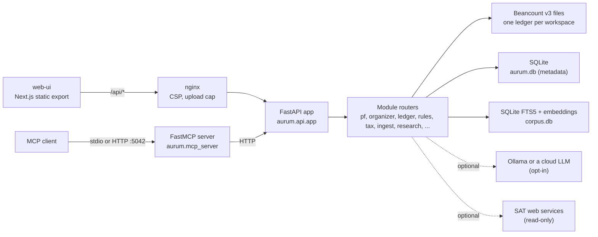

# Architecture

How Aurum is put together: the principles every module follows, the repository layout, the module
conventions, the core types and where data lives. Per-module reference docs are in
[`modules/`](modules/); the product scope is in [`SPEC.md`](SPEC.md).

## Contents

- [Principles](#principles)
- [System overview](#system-overview)
- [Repository layout](#repository-layout)
- [Module conventions](#module-conventions)
- [Core types](#core-types)
- [Data on disk](#data-on-disk)
- [Request path and security layers](#request-path-and-security-layers)
- [Testing strategy](#testing-strategy)

## Principles

These rules are enforced in code and tests, not just stated.

1. **Math lives in code.** No model output ever becomes a tax figure or a ledger amount. Every tax
   number comes from a rule in `aurum/rules` with a citation, an effective range and test vectors.
   Models only classify, draft prose and summarise.
2. **Money is `Decimal`.** Amounts are serialised as strings with an explicit currency
   (`{"amount": "1234.56", "currency": "MXN"}`) and never become a float, on the server or in the UI.
3. **The ledger is the truth.** Everything financial is a Beancount transaction. SQLite holds metadata
   (labels, budgets, goals, inbox, audit log, rule versions) and never balances.
4. **Cash basis follows SAT's prefill rules.** A PUE invoice counts in its issue month, a payment
   complement (REP) in the month of its `FechaPago`, and a PPD invoice without a REP does not count.
   Bank evidence outranks CFDI issuance when they disagree.
5. **e.firma: read, never sign.** The vault is opt-in, encrypted and used read-only for SAT bulk
   download. Nothing in this repository signs, submits or transmits a filing; filing outputs are
   watermarked DRAFT.
6. **Grounded or silent.** Research answers cite `{law, article, effective date, url, trust tier}` or
   abstain. Corpus text is data, never instructions.
7. **Every figure can explain itself.** Numeric responses can carry an `Explain`: a one-line summary,
   worked steps, citations and the rule versions used.
8. **Never guess a rate.** A constant that was not confirmed in a primary source is flagged
   `verified=False`, and every result that touches it says `(verify)` and carries a lower confidence.
9. **No PII in logs, synthetic fixtures only.** RFC, CURP, SSN, account numbers and bearer tokens are
   masked by a log filter. Demo data and test fixtures use SAT's generic RFCs and invented names.
10. **No machine-specific values.** Everything is an environment variable with a default
    (`AURUM_*`, `OLLAMA_URL`); see [`../.env.example`](../.env.example).
11. **Nothing is deleted.** Editing or deleting a movement appends a reversing transaction (void
    semantics); accounts are archived, fixed payments are cancelled, workspaces are hidden. Backups
    come first, and a restore only ever writes into a new directory.

## System overview



Two containers run in Docker Compose: `api` (FastAPI, every Python module, and the MCP server over
HTTP) and `web-ui` (the static Next.js export served by nginx, which proxies `/api` to `api`). Ollama,
when used, runs on the host.

## Repository layout

```text
aurum/
  api/           app.py: builds the FastAPI app and mounts every module router that exists
  core/          config (env), db (SQLite + migrations), explain, money, workspaces, audit,
                 security (headers, rate limit, PII log filter), guards (Host/Origin/path), token,
                 netguard (SSRF), backup, i18n (ES/EN strings for explanations)
  ledger/        LedgerStore protocol, Beancount v3 store, statements, chart-of-accounts templates
  rules/         the rule registry: mx/ (RESICO, IVA, general regime, Nuevo León payroll),
                 us/ (federal, Texas), crossborder/, vectors/*.yaml (test vectors per rule)
  tax/           RESICO prefill audit and month close (DRAFT PDF)
  taxus/         US and Texas estimates, "organize for your preparer"
  pf/            personal finance: accounts, entries, labels, income streams, budgets, goals,
                 credit, review, onboarding, migrations
  organizer/     the money organizer: recurring-payment detection, calendar, forecast, safe to spend
  ingest/        CFDI 4.0 parser, bank CSV import, receipts (OCR), quick add, inbox, reconcile
  satsync/       SAT bulk download client (read-only) and the encrypted e.firma vault
  corpus/        law corpus: ingest, chunking, FTS5 + embeddings, hybrid search, cite-or-abstain
  llm/           provider router (Ollama, LM Studio, OpenAI, Claude, custom), structured output
  research/      cited Q&A over the corpus and a retrieval eval set
  updater/       law tracker: sources, change detection, versioned re-index, impact triage
  insights/      deterministic nudges, digest, optional Telegram webhook
  business/      business workspaces: charts of accounts, payroll, invoices, KPIs
  crossborder/   MX/US residency, treaty tie-breaker, FBAR, FEIE vs FTC
  holdings/      investment trades, lots, prices, contribution limits
  creditreport/  Buró de Crédito report import
  fx/            exchange rates
  plan/          scenario engine: debt payoff, buy vs rent, cash vs credit, retirement (Monte Carlo),
                 MX regime and US entity comparisons
  reports/       bilingual PDF/HTML report packs composed from the other modules
  workflows/     YAML-defined sequences of in-process API calls, with a runner and a scheduler
  mcp_server/    FastMCP server exposing ten tools over stdio or HTTP
  demo/          synthetic demo workspaces
web-ui/          Next.js 15 app (static export), nginx image, UI checks and tests
tests/           pytest suite, one folder per module; fixtures/law holds synthetic law excerpts
scripts/         law ingest, license audit, restore, Telegram nudges, end-to-end verification
docker/          entrypoint and privilege-drop scripts for the API image
docs/            this documentation
```

## Module conventions

- **Routers by convention.** Each module exposes `router: fastapi.APIRouter` in
  `aurum/<module>/router.py`. `aurum/api/app.py` mounts each one under its prefix (`/api/pf`,
  `/api/tax`, `/api/watch`, ...). A module that is not present is skipped with a log line instead of
  failing the boot; any other import error still fails loudly. `GET /api/mounted` lists what was
  mounted.
- **Schema by convention.** A module may ship `schema.sql` with idempotent
  `CREATE TABLE IF NOT EXISTS` statements and module-prefixed table names (`pf_labels`,
  `ingest_inbox`, ...). `aurum.core.db.connect()` applies every schema on first open.
- **Migrations.** A module may ship `migrations.py` with `MIGRATIONS: list[(version, name, fn)]`.
  `connect()` runs pending ones in order, each in its own transaction, and records them in
  `core_schema_migrations`. Migrations never delete user data; a data migration that could change money
  on a protected workspace aborts unless `AURUM_MIGRATE_PROTECTED=1`; a database written by a newer
  version refuses to start.
- **Rules.** A rule is `id · version · jurisdiction · citation · effective_from/to · compute(**inputs)`
  and returns a `RuleResult(value, explain)`. `registry.get(id, on=date)` returns the version in force
  on that date, and `id@version` pins one. Every registered rule must have a vector file under
  `aurum/rules/vectors/`, which the test suite enforces.
- **i18n.** The UI is Spanish-first with English as the second language; explanation strings produced
  by the API go through `aurum.core.i18n` so `Explain.summary` follows the request language.

## Core types

```python
# aurum/core/money.py
class Amount(BaseModel):
    amount: Decimal          # serialised as a string
    currency: str = "MXN"    # ISO 4217

# aurum/core/explain.py
class Citation(BaseModel):
    law: str                 # "LISR", "LIVA", "CFF", "RMF 2026", "IRC", ...
    article: str             # "113-E"
    url: str | None
    effective_from: date | None
    effective_to: date | None
    trust_tier: Literal["primary", "official_guidance", "professional", "blog"]
    excerpt: str | None

class Step(BaseModel):
    label: str
    formula: str | None
    value: str               # str(Decimal)
    id: str | None           # stable machine id for the UI to translate

class Explain(BaseModel):
    summary: str
    steps: list[Step]
    citations: list[Citation]
    rule_versions: list[str] # "mx.resico.isr_monthly@2026.1"
    confidence: float | None # None = full confidence; lower when an input is unverified
```

The UI renders an `Explain` at three depths: the one-line summary, the worked steps, and the cited
statute excerpt.

## Data on disk

Everything lives under `AURUM_DATA_DIR` (`./data` locally, `/data` in the container, a bind mount in
Compose). The directory is gitignored.

```text
data/
  aurum.db                      metadata: labels, budgets, goals, inbox, audit, rule versions, organizer
  corpus.db                     law corpus: chunks, FTS5 index, embeddings, source versions
  workspaces/<id>/
    workspace.json              kind, jurisdictions, base currency, language, profile, UI mode,
                                enabled modules, protected and hidden flags
    accounts.beancount          option header and one open directive per account
    main.beancount              includes accounts.beancount, then appended transactions
    docs/                       CFDI XML, receipt photos (EXIF stripped), generated PDFs
  secrets/api_token             auto-generated bearer token when the API is exposed
  vault/                        encrypted e.firma (opt-in)
  backups/                      full data backups with a sha256 manifest
```

Workspaces are isolated: each has its own ledger files and every metadata row carries a `ws_id`. The
`personal` workspace is protected by default (`AURUM_PROTECTED_WORKSPACES` extends the list): it cannot
be unprotected through the API, and the verification scripts refuse to run against it.

## Request path and security layers

A request from the browser goes through nginx (security headers, CSP, upload cap) and then the API's
own middleware: Host / Origin / path guards, an optional bearer token (required automatically when the
API is bound off loopback), a per-IP rate limit, a streamed body-size cap, and strict validators before
any ledger write. The full model, with how to verify each layer, is in [`SECURITY.md`](SECURITY.md).

## Testing strategy

- **Rules are tested with vectors.** Each rule has YAML cases with inputs, the expected amount and
  required explain text; one test runs every case and fails if a rule has no vector file.
- **Property tests for money.** Hypothesis checks rounding, proportional splits that always sum to
  the total, add/subtract round trips, and that a float is rejected where an amount is expected.
- **API tests through `TestClient`** on throwaway data directories; no test touches `./data`.
- **No network in tests.** The LLM, SAT and HTTP fetchers are faked; the law corpus uses synthetic
  excerpts in `tests/fixtures/law`, and embeddings can use an offline hash backend.
- **UI checks.** Vitest for the client layer, plus lint rules that fail on untranslated strings,
  banned vocabulary and low-contrast colour pairs.
- **End-to-end.** `scripts/verify_demo.py` drives the running stack (API and MCP) through the demo
  flows and an acceptance list on a throwaway workspace.
